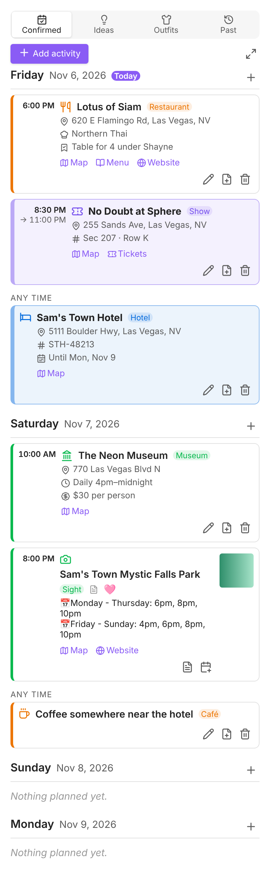
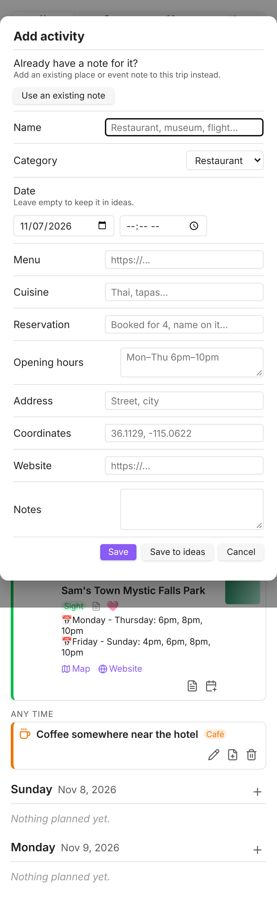
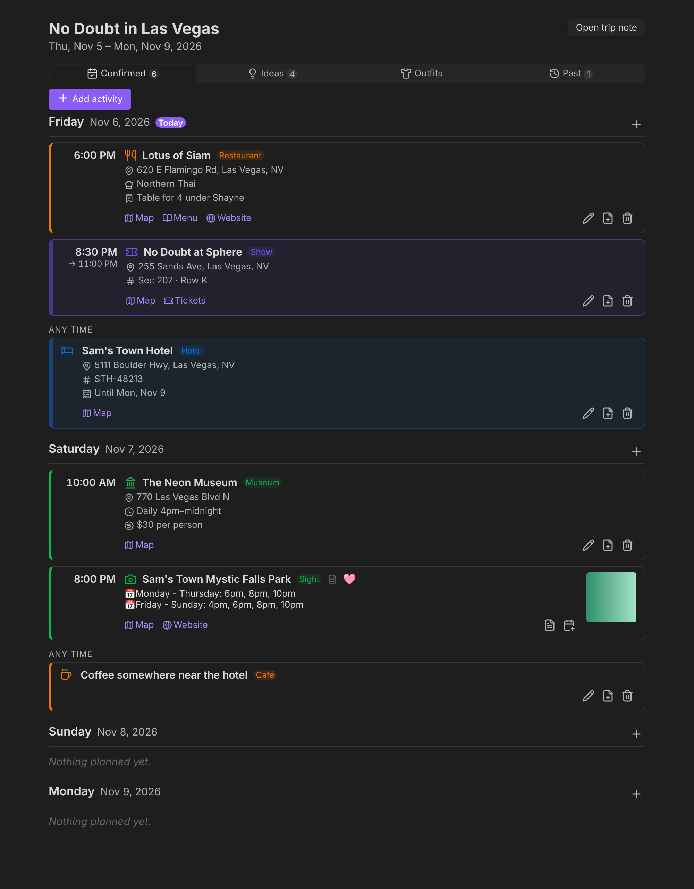

# Travel Planner for Obsidian

Plan trips inside the Trip notes you already have. Add a restaurant, sight, show or flight from a short form,
without creating a separate note. Your existing Place and Event notes still show up, and any quick entry can be turned into
a standalone note later.

**Status: 0.2.0, early beta.** Use it on a copy of your vault first. See [Testing before real use](#testing-before-real-use).

<p>


</p>



## What it does

- **Tabs:** Confirmed · Ideas · Past (plus Outfits when outfit cards are turned off).
  - **Confirmed:** activities dated today or later, grouped by day. Today's activities stay here all day, even after their time
    has passed. Only days with something planned are listed; each has a **+** button.
  - **Ideas:** activities with no date, grouped by category.
  - **Past:** activities dated before today.
  - **Outfits** (only with outfit cards off): your existing `Embeds.base#TripOutfits` view, rendered unchanged.
- **Each day's outfit.** Inside each day's first card, on the right, in the style of the outfit strip: the outfit's photo (its `Image`
  property, or the first image in the note), any other outfits that day as "+ name", and small icons for make-up,
  lockets, watch bands and manicures. Outfits and extras are found the way the strip finds them: notes tagged `outfit`
  (or one of the extras' tags) whose `Dates` property links to that day's daily note (`[[2026-11-22]]`). A coming day
  with no outfit shows a dashed **+ pick**. Tapping a photo, name or icon opens that note. Nothing about outfits is
  written or changed.
- **Weather.** Add a `Location` property to the Trip note — a city (`Reno, NV`) or coordinates (`39.53, -119.81`) — and
  each day's first card shows that day's forecast beside its time, one line each: the sky icon, ↑ high, ↓ low, and a
  raindrop with the chance of rain when there is one. It comes from Open-Meteo (free, no account), is cached on each device for three hours, and is never
  written to notes. Forecasts reach about 16 days ahead; Past keeps about three months.
- **Quick add.** Name is the only required field. Categories are your own travel tags: food, sight, museum, outdoors,
  activity, tour, shopping and accomodations (hotels and flights), plus show, event and other place. The form changes with
  the category: menu, cuisine and reservation for food; hours, price and tickets for sights and museums; end time, tickets
  and confirmation for activities and tours; end date, airline or company, and confirmation for accomodations.
  **Save to ideas** keeps it undated.
- **Existing notes keep working.** Place and Event notes that link to the Trip (through `Projects` or any other link, the same
  rule as your `TripEvents` base view) appear in the itinerary using their own `Date`, `End_Date`, `Address`, `Geolink`,
  `Link`, `Notes`, `Image` and `Rating`. Their tags decide what they are. Their `Date` decides when.
- **Finds notes you already have.** As you type a name in the add form, a dropdown lists matching Place/Event notes
  from your vault (any word order, accents and apostrophes ignored). Picking one adds that note to the trip as a *visit*
  instead of creating a duplicate. A visit has its own day and time, so the same note can be visited twice, or on
  different trips, without editing the note. **Change** goes back to a new quick entry.
- **Look up (optional).** Tap **Look up** next to the name to search OpenStreetMap. Each place it finds shows its
  address and exactly which empty fields it would fill (address, coordinates, website, phone, and opening hours or cuisine
  when the category has them). **Yes, use this** fills them in for you to check before saving; **No** discards the
  results. Nothing you typed is overwritten, and nothing is fetched unless you tap it. Menus and prices aren't available
  from any free source, so those stay manual. Turn the button off in settings.
- **Category chips and a day list.** Categories are buttons at the top of the form; **Day** lists the trip's days, plus
  "No date (idea)" and "Another date…".
- **Convert to note.** Turns a quick entry into a Markdown note with your property names (`tags`, `Projects`, `Date`, `Address`, …),
  optionally starting from a template. The entry keeps its place in the itinerary. The note is created before the Trip is
  changed, so a failure never loses the entry.
- **Map, menu, website and ticket links** on each card. Maps can open in Google Maps, Apple Maps or the device's maps app
  (Android).
- **Colours by category, from your theme:** food orange; sight, museum and outdoors green; activity, tour, show and event
  your accent colour; accomodations blue; shopping pink. Activities, tours, events and accomodations are bookings, so their
  cards are tinted. Existing notes take the colour of whichever of their tags names a category.

## Install (BRAT)

1. Install **BRAT** from Community plugins.
2. BRAT → **Add beta plugin** → `theshayneb/travel-planner`.
3. Enable **Travel Planner** in Settings → Community plugins.

To have it on every device, turn on **Settings → Sync → Vault configuration sync → Installed community plugins** (and
**Active community plugin list**) on the desktop, phone and tablet. Restart Obsidian after a plugin update arrives through Sync.

## Put the planner in a Trip note

Run **Insert planner block** in a Trip note, or type:

````markdown
```travel-planner
confirmed, ideas, outfits, past
```
````

That shows all four tabs in one place.

### In the Trip template's Plans column (recommended)

Keep the Meta Bind tab bar and the Outfits embed exactly as they are, and let the planner fill Confirmed, Ideas and Past.
Open the note (your Trip template, or any existing trip) and run **Use the planner in this note's plans tabs**. It changes
only these three lines, keeping their `>` prefix, and it's one undoable edit:

````markdown
> > > > [!tabbed-box]
> > > > > [!div-m]
> > > > >
> > > > > ```travel-planner
> > > > > confirmed
> > > > > ```
> > > >
> > > > > [!div-m]
> > > > >
> > > > > ```travel-planner
> > > > > ideas
> > > > > ```
> > > >
> > > > > [!div-m]
> > > > >
> > > > > ![[Embeds.base#TripOutfits|no-toolbar]]
> > > >
> > > > > [!div-m]
> > > > >
> > > > > ```travel-planner
> > > > > past
> > > > > ```
````

Running the command on the template means new
trips get the planner. Run it on existing trips one at a time when you want them to use it; trips you don't convert keep
working with the old embeds.

`Embeds.base` itself is never modified, and putting the old embeds back undoes the change.

**Open full-screen planner for this trip** (`hybrid-travel-planner:open-planner`) opens a larger view in its own tab.
Like adding, it's a command, so it can sit on a Meta Bind button of your own. Each day's **+** adds to that day.

### A trip's planner in any note

A `travel-planner` block can show any trip, anywhere, for example on a dashboard or a daily note:

````markdown
```travel-planner
trip: [[No Doubt in Las Vegas]]
full
```
````

- `trip:` a link or name of the Trip note, or `next` for the trip under way today, otherwise the next one to start.
  Leave it out to use the note the block is in, as before.
- `full` shows the full-screen layout: the trip's title and dates and an **Open trip note** button above the tabs.
- A line of tabs (`confirmed, ideas, past`) still picks which tabs to show; leave it out for all of them.

The **Add activity to this trip** and **Open full-screen planner** commands also work in a note with an embedded
planner: they use that planner's trip.

### An Add activity button where you want it

In Trip notes, adding is the command **Travel Planner: Add activity to this trip**
(`hybrid-travel-planner:add-activity`), so you can put a Meta Bind button anywhere in the note or the template:

````markdown
```meta-bind-button
label: Add activity
style: primary
actions:
  - type: command
    command: hybrid-travel-planner:add-activity
```
````

It opens the add form for the trip note it's in. It also works from the command palette and can have a hotkey.

## Where the data lives

Quick entries and visits are stored in the Trip note itself, in one block the plugin appends at the end:

````markdown
```travel-planner-data
{
  "version": 1,
  "items": [
    { "id": "item-m3x8…", "source": "inline", "kind": "place", "category": "restaurant",
      "name": "Lotus of Siam", "date": "2026-05-16", "time": "18:00", "menu": "https://…" },
    { "id": "item-m3x9…", "source": "note", "path": "Places/Sam's Town Mystic Falls Park.md",
      "kind": "place", "category": "sight", "name": "Sam's Town Mystic Falls Park", "date": "2026-05-16", "time": "20:00" }
  ]
}
```
````

- With the plugin on, the block shows as a single line ("Travel planner data: 2 entries"). With it off, it is readable JSON.
- The plugin only ever rewrites that block, through Obsidian's atomic `vault.process`. Frontmatter, Meta Bind, DataviewJS,
  callouts, Map View and everything else stay byte-for-byte unchanged. Opening an old Trip writes nothing.
- If the block is damaged, or a sync conflict leaves two blocks or duplicate IDs, the planner shows the error and refuses to
  write until it is fixed. It never overwrites data it can't read.
- Renaming or moving a note that a visit points to updates the visit.
- Quick entries are not separate files, so Bases can't list them. Your existing bases keep showing your existing notes.

## Sync across Windows, Android phone and tablet

Everything a trip needs is in synced Markdown files (the Trip note and your Place/Event notes). Nothing lives in a local
database. Settings are in the plugin's `data.json`, which Vault configuration sync carries. The plugin uses no desktop-only
APIs (`isDesktopOnly: false`). The planner redraws when a synced change arrives, and moves today's activities to Past at
midnight.

Obsidian Sync merges Markdown edits made on two devices before they sync. If that ever produces a damaged data block, the
planner stops writing and says so, instead of guessing. Avoid editing the same trip on two offline devices at once.

## Settings

| Setting | Default |
|---|---|
| Trip tag / not a trip if tagged | `travel` / `event` |
| Place tag / event tag | `place` / `event` |
| Ignore notes tagged / ignore folders | `journal_entry` / `Templates` |
| Property names | `Date`, `End_Date`, `Projects`, `Address`, `Geolink`, `Link`, `Phone`, `Notes`, `Image`, `Rating`, `Menu`, `Hours`, `Location`, `Dates`, `Sub_Type` |
| Maps | Google Maps |
| Look up places online | on (only runs when you tap **Look up**) |
| Outfit under each day / outfit tag | on / `outfit` |
| Outfit icons | make-up eyeshadow, eyeliner 🖌️, lipstick 💄, other make-up 🎨, locket 💎, watch band ⌚, manicure 💅 |
| Weather / temperature | on / Fahrenheit |
| Outfits tab / embed (outfit cards off) | on / `![[Embeds.base#TripOutfits\|no-toolbar]]` |
| Folder / template for converted notes | next to the trip / none |

## Not yet implemented

- Drag-and-drop reordering and collapsible days.
- On-device verification of the Outfits tab inside the full-screen view (the embedded tabs are unaffected; the tab also
  has an **Open outfits in the trip note** button as a fallback).

## Testing before real use

On a copy of the vault, on each device:

| Test | Expected |
|---|---|
| Open an old Trip | Displays its linked notes; the file is not modified |
| Add an inline restaurant | No new note is created; it appears on its day |
| Save to ideas, then edit and give it a date | Moves from Ideas to Confirmed |
| An activity dated yesterday | In Past |
| An activity earlier today | Still in Confirmed |
| Type the name of a note you already have, pick it from the dropdown | One card, linked to the note, not two |
| Convert an inline entry to a note | New note with tags, `Projects`, `Date`; same position in the itinerary |
| Rename a note used by a visit | The visit still resolves |
| Outfits tab | Identical to before |
| Disable the plugin | Trip note still readable; data block is plain JSON |
| Add on the phone, open on the desktop after sync | Same itinerary on both |

## Development

```bash
npm install
npm run check   # TypeScript
npm run lint    # Obsidian's ESLint rules
npm test        # unit tests (storage, itinerary, note reading)
npm run build   # main.js
npm run shots   # screenshots of the planner in Chromium (needs Playwright)
```

To release: bump `version` in `manifest.json` and `package.json`, add the version to `versions.json` and `CHANGELOG.md`, commit, then push a tag
equal to the version with no `v` (`git tag 0.3.0 && git push origin 0.3.0`). The release workflow publishes `main.js`,
`manifest.json` and `styles.css`; tags with a `-` (e.g. `0.3.0-beta.1`) become prereleases.
Without pushing a tag, you can also publish from GitHub: **Actions → Release → Run workflow** releases the version in
`manifest.json` and creates its tag.

Design notes and constraints from the planning conversation: [docs/design.md](docs/design.md).
